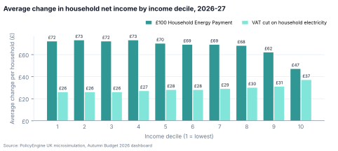
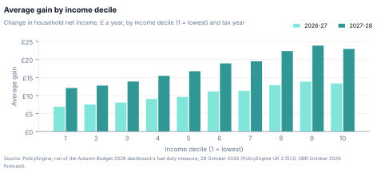
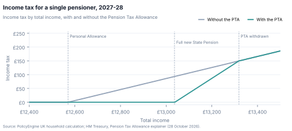
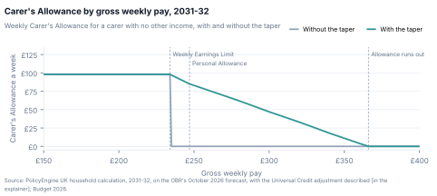
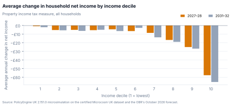
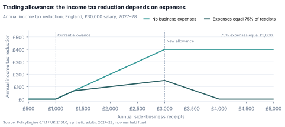

::: {.cover}
# Autumn Budget 2026: the policies explained

**What each measure does, what it costs, and how our estimates compare**

A PolicyEngine briefing · Published 29 October 2026

::: {.cover-links}
[<svg class="icon" viewBox="0 0 24 24" width="12" height="12" fill="none" stroke="#81E6D9" stroke-width="2" stroke-linecap="round" stroke-linejoin="round"><path d="M3 3v18h18"/><path d="M18 17V9"/><path d="M13 17V5"/><path d="M8 17v-3"/></svg>Budget dashboard]{.label}\
[policyengine.org/uk/autumn-budget-2026](https://www.policyengine.org/uk/autumn-budget-2026)

[<svg class="icon" viewBox="0 0 24 24" width="12" height="12" fill="none" stroke="#81E6D9" stroke-width="2" stroke-linecap="round" stroke-linejoin="round"><path d="M15 2H6a2 2 0 0 0-2 2v16a2 2 0 0 0 2 2h12a2 2 0 0 0 2-2V7Z"/><path d="M14 2v4a2 2 0 0 0 2 2h4"/><path d="M10 9H8"/><path d="M16 13H8"/><path d="M16 17H8"/></svg>Household briefing]{.label}\
[policyengine.org/uk/research/uk-autumn-budget-2026-briefing](https://www.policyengine.org/uk/research/uk-autumn-budget-2026-briefing)
:::

[[Funded by]{.funder-text}{.nuffield}]{.funder}
:::

::: {.toc}
[Contents]{.toc-title}

- [At a glance](#at-a-glance)
- [How to read this](#how-to-read-this)
- [In our dashboard](#in-our-dashboard)
    - [Household Energy Payment: £100 for bands A to D in England](#m-energy-payment)
    - [Zero VAT on household electricity runs to 1 July 2027](#m-zero-vat)
    - [Fuel duty: the 5p cut runs to July 2027](#m-fuel-duty)
    - [Pension Tax Allowance](#m-pension-tax-allowance)
    - [Carer's Allowance: a taper above the earnings limit](#m-carers-allowance)
    - [Property income: tax rates up 2 points](#m-property-income)
    - [Savings income: tax rates up 2 points](#m-savings-income)
    - [Trading allowance: £1,000 to £3,000](#m-trading-allowance)
- [Our explainers](#our-explainers)
    - [Analysis of the Autumn Budget 2026 energy bill measures](#e-budget-2026-energy-bills)
    - [The fuel duty cut extension in the Autumn Budget 2026](#e-fuel-duty-cut-extension)
    - [The Pension Tax Allowance in the Autumn Budget 2026](#e-pension-tax-allowance)
    - [The Carer's Allowance earnings taper in the Autumn Budget 2026](#e-carers-allowance-taper)
    - [Autumn Budget 2026: higher tax on property income](#e-uk-autumn-budget-2026-property-income-tax)
    - [Autumn Budget 2026: raising the trading allowance](#e-uk-autumn-budget-2026-trading-allowance)
- [In the Budget, not in our dashboard](#in-the-budget-not-in-our-dashboard)
    - [Triple lock: a new rule from April 2030](#m-triple-lock)
    - [National Living Wage: £13.21 an hour](#m-national-living-wage)
    - [Bank surcharge: 3% to 6% for 15 months](#m-bank-surcharge)
    - [Seven smaller measures](#seven-smaller-measures)
    - [Other measures that reach households](#other-measures-that-reach-households)
    - [Spending on services and compensation](#spending-on-services-and-compensation)
- [On our list, not in the Budget](#on-our-list-not-in-the-budget)
- [Limitations](#limitations)
- [Sources and method](#sources-and-method)
:::

Our figures come from our Budget dashboard at [policyengine.org/uk/autumn-budget-2026](https://www.policyengine.org/uk/autumn-budget-2026), as it stood at revision 17 (2026-10-28 19:24 UTC).

## At a glance

::: {.glance}
[The measures at a glance]{.tcap}

| Measure | What the Budget did | Our estimate |
|:------------------------------|:---------------------------------------------|:-------------------------|
| Household Energy Payment | New: £100 for bands A to D in England | In the dashboard |
| Zero VAT on electricity | Extended it by three months, to 1 July 2027 | In the dashboard |
| Fuel duty | Kept the 5p cut to 1 July 2027, not March 2028 | In the dashboard |
| Pension Tax Allowance | Announced it, with a taper instead of a cliff edge | In the dashboard |
| Carer's Allowance taper | Announced it, from 2030-31, England and Wales | In the dashboard |
| Property income tax | Rates up 2 points from April 2027 | In the dashboard |
| Savings income tax | Rates up 2 points from April 2027 | No national estimate |
| Trading allowance | Raised it from £1,000 to £3,000 from April 2027, not on our list | In the dashboard |
| Triple lock | Changed it from April 2030 | Separate post, pre-Budget scenarios |
| National Living Wage | £13.21 an hour from 1 April 2027 | Not in our model |
| Bank surcharge | 3% to 6% for 15 months, not 8% | Not in our model |
| Seven smaller measures | Student loans, Universal Credit, mileage and more | Not in our model |
| 12 of the 20 on our pre-Budget list, among them the Warm Home Discount top-up | Not in the Budget | — |
:::

In our combined run, the seven measures in the [dashboard](https://www.policyengine.org/uk/autumn-budget-2026) cost £3,110 million in 2026-27 and £615 million in 2027-28, and raise £210 million in 2028-29, when the property income rise outweighs the two tax cuts still in force.

## How to read this {.section-page}

The day before the Budget, we listed the 20 measures we thought it most likely to change. This briefing says what the Budget actually did with each, and adds the measures it made that our list missed. For every measure you will find:

- **What changes**, and when, from the Budget documents.
- **Who it affects**, using the government's own reach figures where it gives them.
- **The official costing**: the government's costing, which the Office for Budget Responsibility (OBR) certifies, from the OBR's [detailed forecast table 1.1](https://obr.uk/efo/economic-and-fiscal-outlook-october-2026/). For a measure in our dashboard we compare with the line or lines of that table that match what we model, and give the total in the Treasury's [Table 6.1](https://www.gov.uk/government/publications/supporting-documents-for-budget-2026) (rounded to the nearest £5 million). We include the measure's other lines for context. Fuel duty is the exception: its official figure is the government's estimate, which the OBR used but could not certify. For other measures we give the OBR's total for the measure. In every table a negative number is a cost to the public finances and a positive number raises money, in £ million.
- **Our estimate**, only where the dashboard publishes one, with the reasons it differs from the official costing.
- **How we model it**, if we do.

After presenting the measures in [our dashboard](https://www.policyengine.org/uk/autumn-budget-2026), we dedicate a page to each of our six policy explainers with their key points and charts.

Our estimates differ from the official costings for four main reasons: timing (we score each tax year's liability; the official costings are on a National Accounts basis, in which the tax people pay through Self Assessment can fall in a later year), coverage (we use household survey data, so we estimate less fully the effects outside households and on incomes the survey records thinly), behaviour (ours are static; most official costings include responses) and scope (the parts of a policy each models).

## In our dashboard {.section-page}

::: {.card}
### Household Energy Payment: £100 for bands A to D in England {#m-energy-payment}

[£100 · council tax bands A to D · England · from January 2027]{.keyfact}

::: {.tags}
[New]{.badge .new} [Replaces our list's no. 5, "Warm Home Discount top-up", which did not happen]{.prev}
:::

[What changes]{.runin} A one-off £100 council tax rebate for households in council tax bands A to D in England, from January 2027. The devolved governments get their share of the funding through the Barnett formula to provide similar support, and councils in England get £100 million more to target the hardest-hit households, some of them above band D.

[Who it affects]{.runin} Up to 20 million households, about 80% of households in England. The government estimates it reaches 83% of fuel-stressed households in England and 88% of households in the bottom three income deciles.

[How we model it]{.runin} £100 to each household in England in bands A to D, which we count as household income in 2026-27. We don't model the devolved governments' share or the £100 million for councils.

[Household Energy Payment: £100 for bands A to D in England, costings, £ million]{.tcap}

| £ million | 2026-27 | 2027-28 | 2028-29 | 2029-30 | 2030-31 | 2031-32 |
|:--------------------------|------:|------:|------:|------:|------:|------:|
| Official: PSCE in RDEL | −2,627 | 0 | 0 | 0 | 0 | 0 |
| Table 6.1 total | −2,625 | 0 | 0 | 0 | 0 | 0 |
| [PolicyEngine]{.ours} | −1,969 | 0 | 0 | 0 | 0 | 0 |

[Why ours differs]{.why} Ours falls 25% below the official £2,627 million because the official figure also covers two things we don't model: the devolved governments' share of the funding (about £425 million, our estimate using the Barnett formula) and £100 million for councils in England to target the hardest-hit households. Without them, about £2,100 million remains for the payment in England, and ours is 94% of that. At £100 each, the up to 20 million households the Budget names take up to £2,000 million of it; neither the OBR nor the Budget itemises the rest.

::: {.readmore}
[Read more]{.label} [Analysis of the Autumn Budget 2026 energy bill measures](https://www.policyengine.org/uk/research/budget-2026-energy-bills)
:::

:::

::: {.card}
### Zero VAT on household electricity runs to 1 July 2027 {#m-zero-vat}

[0% VAT on domestic electricity · to July 2027 · Northern Ireland from April 2027]{.keyfact}

::: {.tags}
[In the Budget, in a different form]{.badge .changed} [Our list: no. 8]{.prev}
:::

[What changes]{.runin} The Budget extends the 0% rate on domestic electricity, in force in Great Britain since 1 October 2026, by three months to July 2027, and expects the rate to apply in Northern Ireland from April 2027; until then Northern Ireland's Executive gets funding for comparable support. We had listed an extension to March 2028.

[Who it affects]{.runin} Around 29 million households across the UK. The Budget expects it to take around £50 off the annual Ofgem price cap in April 2027.

[How we model it]{.runin} VAT on household electricity is 0% instead of 5% from 1 October 2026 to 30 June 2027, in Great Britain from October 2026 and across the UK from April 2027. Each year counts its share of a year's electricity use: about 57% in 2026-27 and 22% in 2027-28. Like the Treasury, we cost the whole period, including the cut already in force this winter. We leave gas VAT as it is.

[Zero VAT on household electricity runs to 1 July 2027, costings, £ million]{.tcap}

| £ million | 2026-27 | 2027-28 | 2028-29 | 2029-30 | 2030-31 | 2031-32 |
|:--------------------------|------:|------:|------:|------:|------:|------:|
| Official: VAT | −734 | −296 | 0 | 0 | 0 | 0 |
| Table 6.1 total | −755 | −305 | 0 | 0 | 0 | 0 |
| [PolicyEngine]{.ours} | −840 | −353 | 0 | 0 | 0 | 0 |

Table 6.1's total also includes the measure's other line in the OBR's table: Other AME (current).

[Why ours differs]{.why} Ours exceeds the official VAT line by £106 million (14%) in 2026-27 and by £57 million (19%) in 2027-28. The official costing also covers charities, residential care and some businesses, and counts households switching from gas to electricity; both make the official figure larger, so neither explains the gap. The two start from different spending. Ours starts from the Department for Energy Security and Net Zero's domestic electricity volumes at the average prices households pay, which we grow with CPI. The official costing instead starts from ONS consumer spending, which is 10% to 12% lower.

::: {.readmore}
[Read more]{.label} [Analysis of the Autumn Budget 2026 energy bill measures](https://www.policyengine.org/uk/research/budget-2026-energy-bills)
:::

:::

::: {.card}
### Fuel duty: the 5p cut runs to July 2027 {#m-fuel-duty}

[Main rate 52.95p a litre · to 1 July 2027 · then 5p and RPI]{.keyfact}

::: {.tags}
[In the Budget, in a different form]{.badge .changed} [Our list: no. 1, "Fuel duty freeze"]{.prev}
:::

[What changes]{.runin} The 5p cut, which holds the main rate at 52.95p a litre, now runs to 1 July 2027 instead of ending in two steps in January and March 2027, and the RPI rise due in April 2027 moves to the same day. On 1 July 2027 rates rise by 5p and by RPI; from 1 April 2028 they rise by RPI each April. We had expected the freeze to run to March 2028.

[Who it affects]{.runin} 35 million motorists and businesses across the UK, the Budget says.

[How we model it]{.runin} The main rate stays at 52.95p a litre to 30 June 2027 and returns to 60.59p from 1 July 2027. We weight rates by days into fiscal years and include the VAT on the lower pump price. Static: households buy the same fuel.

[Fuel duty: the 5p cut runs to July 2027, costings, £ million]{.tcap}

| £ million | 2026-27 | 2027-28 | 2028-29 | 2029-30 | 2030-31 | 2031-32 |
|:--------------------------|------:|------:|------:|------:|------:|------:|
| Official: Fuel Duty | −574 | −782 | 0 | 0 | 0 | 0 |
| Table 6.1 total | −575 | −780 | 0 | 0 | 0 | 0 |
| [PolicyEngine]{.ours} | −301 | −521 | 0 | 0 | 0 | 0 |

[Why ours differs]{.why} The official figure is the government's estimate, which the OBR used but could not certify. Ours is £273 million lower in 2026-27 and £261 million lower in 2027-28. Most of the gap is coverage: we count only the petrol and diesel households buy, about £13 billion of the £24 billion of fuel duty the OBR forecasts for 2026-27, while the official costing also covers the fuel businesses buy. Scaling our fuel duty cost up to the OBR's fuel duty receipts gives about £450 million in 2026-27 and £760 million in 2027-28. VAT and behaviour narrow the gap: ours includes £50 million and £87 million of VAT on the lower pump price, which the official fuel duty figure leaves out, and the official costing's demand response makes its cost smaller. Our inference: the rest of the 2026-27 gap fits the official costing if it assumes the full 5p returns on 1 January 2027 (about £555 million on 45 billion litres), while the law brings back 3p then and 2p from 1 March (about £410 million).

::: {.readmore}
[Read more]{.label} [The fuel duty cut extension in the Autumn Budget 2026](https://www.policyengine.org/uk/research/fuel-duty-cut-extension)
:::

:::

::: {.card}
### Pension Tax Allowance {#m-pension-tax-allowance}

[Up to £94 off income tax · over State Pension age · 6 April 2027 to 5 April 2030]{.keyfact}

::: {.tags}
[In the Budget, in a different form]{.badge .changed} [Our list: no. 3, "State Pension tax protection"]{.prev}
:::

[What changes]{.runin} From 6 April 2027 to 5 April 2030, people over State Pension age, or who reach it during the tax year, get an income tax reduction. Those whose total income from all sources is no more than the full new State Pension get it in full: in 2027-28, 20% of £466.40 (£13,036.40 − £12,570) is £93.28, which rounds up to £94. Above that it falls by £1 for every £3 of income and is gone at £13,319. We had expected a full allowance with a cliff edge; the Budget tapers it instead. Scottish taxpayers get it at 20%.

[Who it affects]{.runin} In 2027-28, around 290,000 pensioners pay no tax because of it and around 500,000 get a reduction; around 1 million by the end of the Parliament ([Treasury explainer](https://www.gov.uk/government/publications/pension-tax-allowance-explainer/pension-tax-allowance-explainer)).

[How we model it]{.runin} A non-refundable reduction in income tax from 2027-28 to 2029-30, worth up to £94 in 2027-28, which falls by £1 for every £3 of total income above the full new State Pension. Total income includes savings interest. We leave the personal allowance as it is. We count people as over State Pension age if they reach it by 6 October, so we leave out people who reach it later in the tax year.

[Pension Tax Allowance, costings, £ million]{.tcap}

| £ million | 2026-27 | 2027-28 | 2028-29 | 2029-30 | 2030-31 | 2031-32 |
|:--------------------------|------:|------:|------:|------:|------:|------:|
| Official: Income tax | 0 | −44 | −83 | −144 | +49 | −15 |
| Table 6.1 total | 0 | −45 | −90 | −150 | +50 | −15 |
| [PolicyEngine, net of benefit savings]{.ours} | 0 | −30 | −83 | −144 | 0 | 0 |

Table 6.1's total also includes the measure's other lines in the OBR's table: PSCE in RDEL, Scottish BGA (current) and Scottish self-financed expenditure.

[Why ours differs]{.why} Our income tax cost is £42 million, £112 million and £193 million in 2027-28, 2028-29 and 2029-30. The official income tax line is £44 million, £83 million and £144 million, so ours is about 5% lower in 2027-28 and 35% and 34% higher in the next two years. The table shows our net cost, after Pension Credit, Housing Benefit and Council Tax Reduction take back part of the income tax cut; the measure's Welfare inside cap line in the OBR's table is zero. For 2028-29 and 2029-30 we set the allowance at £182 and £250 a year, from the October 2026 forecast of the State Pension. The official costing also has figures for 2030-31 and 2031-32. The Treasury's [policy costing note](https://www.gov.uk/government/publications/supporting-documents-for-budget-2026) gives no reason for these figures after the allowance ends; ours are zero.

::: {.readmore}
[Read more]{.label} [The Pension Tax Allowance in the Autumn Budget 2026](https://www.policyengine.org/uk/research/pension-tax-allowance)
:::

:::

::: {.card}
### Carer's Allowance: a taper above the earnings limit {#m-carers-allowance}

[100% taper above the Weekly Earnings Limit · England and Wales · during 2030-31]{.keyfact}

::: {.tags}
[In the Budget]{.badge .announced} [Our list: no. 2]{.prev}
:::

[What changes]{.runin} Carers no longer lose all of Carer's Allowance when they earn more than the [Weekly Earnings Limit](https://www.gov.uk/carers-allowance). Above the limit, which equals 16 times the National Living Wage (16 × £13.21 = £211.36 a week at April 2027's rate), the allowance falls by £1 for each £1 of earnings, a 100% taper. It applies in England and Wales and starts during 2030-31, once a new IT system is in place.

[Who it affects]{.runin} Around 48,000 carers in England and Wales, the Budget says.

[How we model it]{.runin} In England and Wales, carers whose weekly net earnings exceed the limit, which we take as 16 hours at the OBR's forecast of the National Living Wage for that April, rounding up to the pound (£228 a week in 2030-31 and £234 in 2031-32), keep the allowance less £1 for each £1 of earnings above the limit. We count half of 2030-31. Static: no change in how much carers work. One limitation: for a carer on Universal Credit, the model counts the extra allowance in full as unearned income but deducts none of the income tax on it from earnings, so such a carer can lose overall.

[Carer's Allowance: a taper above the earnings limit, costings, £ million]{.tcap}

| £ million | 2026-27 | 2027-28 | 2028-29 | 2029-30 | 2030-31 | 2031-32 |
|:--------------------------|------:|------:|------:|------:|------:|------:|
| Official: Welfare inside cap | 0 | 0 | 0 | 0 | −33 | −69 |
| Table 6.1 total | 0 | 0 | 0 | 0 | −40 | −80 |
| [PolicyEngine, net of income tax]{.ours} | 0 | 0 | 0 | 0 | −24 | −48 |

Table 6.1's total also includes the measure's other line in the OBR's table: Scottish BGA (current).

[Why ours differs]{.why} The measure's total in the OBR's table is £38 million in 2030-31 and £79 million in 2031-32, before the Treasury rounds it to the nearest £5 million. It includes £5 million and £10 million of extra block grant for Scotland, which runs its own carer benefit, and has no line for income tax. Its Carer's Allowance and Universal Credit spending, the Welfare inside cap line, is £33 million and £69 million. Ours, £24 million and £48 million, is net of the income tax on the higher allowance (£15 million and £32 million); before that tax, ours is about £39 million and £79 million, a sixth more than the official Welfare inside cap line.

::: {.readmore}
[Read more]{.label} [The Carer's Allowance earnings taper in the Autumn Budget 2026](https://www.policyengine.org/uk/research/carers-allowance-taper)
:::

:::

::: {.card}
### Property income: tax rates up 2 points {#m-property-income}

[24%, 44% and 49% · from 6 April 2027 · England, Wales and Northern Ireland]{.keyfact}

::: {.tags}
[In the Budget, in a different form]{.badge .changed} [Our list: part of no. 14, "Unearned income tax"]{.prev}
:::

[What changes]{.runin} From 6 April 2027, the income tax rates on property income rise a further 2 points, on top of [Budget 2025's rise](https://www.gov.uk/government/publications/changes-to-tax-rates-for-property-savings-and-dividend-income), to 24%, 44% and 49% in England, Wales and Northern Ireland. Finance cost relief for landlords still follows the property basic rate. Dividend rates, which our list expected to rise too, stay the same.

[Who it affects]{.runin} Landlords and others with property income in England, Wales and Northern Ireland.

[How we model it]{.runin} The three rates rise to 24%, 44% and 49% from 2027-28. Finance cost relief follows the property basic rate to 24%, for Scottish landlords too. We hold incomes fixed, with no behavioural response.

[Property income: tax rates up 2 points, costings, £ million]{.tcap}

| £ million | 2026-27 | 2027-28 | 2028-29 | 2029-30 | 2030-31 | 2031-32 |
|:--------------------------|------:|------:|------:|------:|------:|------:|
| Official: Income tax | 0 | 0 | +539 | +394 | +403 | +412 |
| Table 6.1 total | 0 | +35 | +575 | +435 | +445 | +455 |
| [PolicyEngine]{.ours} | 0 | +399 | +412 | +429 | +446 | +459 |

Table 6.1's total also includes the measure's other lines in the OBR's table: Onshore CT, Scottish BGA (current) and Scottish self-financed expenditure.

[Why ours differs]{.why} The official costing puts the tax people pay through Self Assessment in a later year than the one they owe it for: the OBR adds almost no Self Assessment receipts from the savings and property rate rises in 2027-28 and £1.0 billion in 2028-29 ([Economic and fiscal outlook](https://obr.uk/efo/economic-and-fiscal-outlook-october-2026/), Table 4.4), so the official figures for those two years aren't comparable with our tax-year figures. From 2029-30 ours exceeds the official income tax line by 9% to 11%. The official costing includes small behavioural responses, more tax-motivated incorporation and higher non-compliance, that reduce the yield by £0.1 billion a year ([Economic and fiscal outlook](https://obr.uk/efo/economic-and-fiscal-outlook-october-2026/), paragraph 3.17); ours leaves them out, so before them the official income tax line would exceed ours.

::: {.readmore}
[Read more]{.label} [Autumn Budget 2026: higher tax on property income](https://www.policyengine.org/uk/research/uk-autumn-budget-2026-property-income-tax)
:::

:::

::: {.card}
### Savings income: tax rates up 2 points {#m-savings-income}

[24%, 44% and 49% · from 6 April 2027 · across the UK]{.keyfact}

::: {.tags}
[In the Budget, in a different form]{.badge .changed} [Our list: part of no. 14, "Unearned income tax"]{.prev}
:::

[What changes]{.runin} From 6 April 2027, the income tax rates on savings income rise a further 2 points, on top of [Budget 2025's rise](https://www.gov.uk/government/publications/changes-to-tax-rates-for-property-savings-and-dividend-income), to 24%, 44% and 49% across the UK.

[Who it affects]{.runin} Savers with taxable interest above their Personal Allowance, Personal Savings Allowance and starting rate for savings. Interest in ISAs stays tax-free.

[How we model it]{.runin} Our national estimates leave this measure out, because the savings income in our data isn't yet good enough for a national figure. The [dashboard's household calculator](https://www.policyengine.org/uk/autumn-budget-2026) includes it.

[Savings income: tax rates up 2 points, costings, £ million]{.tcap}

| £ million | 2026-27 | 2027-28 | 2028-29 | 2029-30 | 2030-31 | 2031-32 |
|:--------------------------|------:|------:|------:|------:|------:|------:|
| Official: Income tax | 0 | +63 | +483 | +443 | +475 | +510 |
| Table 6.1 total (row 62) | +15 | +125 | +555 | +520 | +555 | +590 |

Table 6.1's total also includes the measure's other line in the OBR's table: Onshore CT.

The official costing includes some savers moving their savings into ISAs and other tax-advantaged products.
:::

::: {.card}
### Trading allowance: £1,000 to £3,000 {#m-trading-allowance}

[£1,000 to £3,000 · from 6 April 2027 · income tax and Class 4 National Insurance]{.keyfact}

::: {.tags}
[New]{.badge .new} [Not on our list]{.prev}
:::

[What changes]{.runin} From 6 April 2027 the trading allowance triples from £1,000 to £3,000, so up to £3,000 of trading and miscellaneous income a year is tax-free.

[Who it affects]{.runin} People with small amounts of trading or miscellaneous income. The Budget presents it as support for entrepreneurs taking the first steps in starting a small business.

[How we model it]{.runin} The allowance rises to £3,000 from 2027-28 for income tax and Class 4 National Insurance. Without gross receipts in the data, the model relieves a profit up to £3,000 in full and gives no relief above it, so the model may overstate the cost for some people and understate it for others.

[Trading allowance: £1,000 to £3,000, costings, £ million]{.tcap}

| £ million | 2026-27 | 2027-28 | 2028-29 | 2029-30 | 2030-31 | 2031-32 |
|:--------------------------|------:|------:|------:|------:|------:|------:|
| Official: Income tax and NICs | 0 | 0 | −221 | −165 | −171 | −178 |
| Table 6.1 total | 0 | 0 | −225 | −165 | −175 | −180 |
| [PolicyEngine]{.ours} | 0 | −110 | −118 | −119 | −120 | −130 |

Table 6.1's total also includes the measure's other lines in the OBR's table: PSCE in RDEL, Scottish BGA (current) and Scottish self-financed expenditure.

[Why ours differs]{.why} From 2028-29 ours falls £46 million to £103 million a year below the official income tax and NICs lines (27% to 47%), with the largest gap in 2028-29. The official costing includes people switching from deducting their actual expenses to the larger allowance, which we don't model. Without gross receipts in the survey data, we give traders with profits above £3,000 nothing from the change and give miscellaneous income no allowance at all, while for some profits between £1,000 and £3,000 we overstate the gain, because we leave them unrelieved under the current £1,000 allowance. In 2027-28 the official lines have no cost and ours has £110 million. The [dashboard](https://www.policyengine.org/uk/autumn-budget-2026) gives the reason in its description of the comparison: the official costings are on a National Accounts basis, in which the tax people pay through Self Assessment can fall in a later year, so a change such as the trading allowance can appear about a year later in them than in ours.

::: {.readmore}
[Read more]{.label} [Autumn Budget 2026: raising the trading allowance](https://www.policyengine.org/uk/research/uk-autumn-budget-2026-trading-allowance)
:::
:::

## Our explainers {.section-page}

We have published six explainers, which together cover the seven measures in [our dashboard](https://www.policyengine.org/uk/autumn-budget-2026): one covers both energy measures. Each of the next six pages quotes an explainer's key points from [policyengine.org](https://www.policyengine.org) and includes one of its charts, using the post's own chart data. The three income decile charts show the dashboard's results. We have simplified references to other parts of the posts using square brackets. Please refer to the posts for the full details.

::: {.explainer}
### [Analysis of the Autumn Budget 2026 energy bill measures](https://www.policyengine.org/uk/research/budget-2026-energy-bills) {#e-budget-2026-energy-bills}

This post covers the Household Energy Payment and the three more months of zero VAT on household electricity. It counts the households that get the payment by dividing our cost of it by £100.

Key results for 2026-27:

- The two measures cost £2.81 billion: £1.97 billion for the payment and £0.84 billion for the VAT cut
- 19.7 million households in England, 80.6% of the total, receive the £100 payment
- Household net income increases by an average of £96 per UK household
- The Gini index of income inequality falls by 0.12% from the payment and 0.04% from the VAT cut

[Average change in household net income by income decile, 2026-27, from the energy bill measures]{.figcap}

[{.chart}](https://www.policyengine.org/uk/research/budget-2026-energy-bills)\
:::

::: {.explainer}
### [The fuel duty cut extension in the Autumn Budget 2026](https://www.policyengine.org/uk/research/fuel-duty-cut-extension) {#e-fuel-duty-cut-extension}

Key figures:

- The main rate of fuel duty stays at 52.95p a litre to 30 June 2027. Before the Budget, the rate was due to rise to 55.95p on 1 January 2027 and 57.95p on 1 March 2027, with an RPI increase planned for April 2027.
- On 1 July 2027, the rate rises to 60.59p. From that date, on our assumption for April 2027, it follows the same path as before the Budget.
- With the VAT on the duty, a litre costs 3.6p less in January and February 2027, 6.0p less in March 2027 and 9.2p less from April to June 2027.
- A household that uses 1,000 litres of fuel a year, about 19 litres a week, pays £34 less in total: £12 in 2026-27 and £22 in 2027-28.
- PolicyEngine estimates that the measure costs £301 million in 2026-27 and £521 million in 2027-28 on fuel that households buy, and nothing in later years. For context, the government estimates that it reduces fuel duty receipts by £574 million and £782 million. The OBR used that estimate in its forecast but could not certify it ([Economic and fiscal outlook, October 2026](https://obr.uk/efo/economic-and-fiscal-outlook-october-2026/), chapter 3 and detailed forecast tables, policy, Table 1.1).
- In 2027-28, household net income rises by £18 a year on average, from £12 in the lowest income decile to £24 in the ninth.

[Average gain from the fuel duty measure by income decile, 2026-27 and 2027-28]{.figcap}

[{.chart}](https://www.policyengine.org/uk/research/fuel-duty-cut-extension)\
:::

::: {.explainer}
### [The Pension Tax Allowance in the Autumn Budget 2026](https://www.policyengine.org/uk/research/pension-tax-allowance) {#e-pension-tax-allowance}

Key figures for 2027-28:

- The full new State Pension is £13,036 a year, £466 above the £12,570 Personal Allowance.
- The full PTA is £94.
- A pensioner with the standard Personal Allowance, income taxed at the 20% basic rate and total income up to £13,036 pays no income tax.
- The PTA falls by £1 for each £3 of income above £13,036 and reaches zero at £13,319.
- In that withdrawal range, a taxpayer outside Scotland has an effective marginal tax rate of 53.3%, against 20% without the PTA.
- For a pensioner who claims means-tested benefits, those benefits fall as income tax falls, so net income rises by less than the PTA. A Pension Credit claimant aged 75 or over without Savings Credit can lose up to £180, because leaving Pension Credit ends the free TV licence.

[Income tax for a single pensioner by total income in 2027-28, with and without the Pension Tax Allowance]{.figcap}

[{.chart}](https://www.policyengine.org/uk/research/pension-tax-allowance)\
:::

::: {.explainer}
### [The Carer's Allowance earnings taper in the Autumn Budget 2026](https://www.policyengine.org/uk/research/carers-allowance-taper) {#e-carers-allowance-taper}

Key figures for 2031-32:

- The Weekly Earnings Limit is 16 hours at the National Living Wage, rounded up to the next pound: £234 a week, on the OBR's forecast for April 2031.
- PolicyEngine UK projects Carer's Allowance at £98 a week.
- Under current rules, the earnings limit is a cliff: a carer whose net earnings exceed the limit by any amount, even 1p, loses the whole allowance for that week. With the taper, the allowance falls by £1 for each £1 above the limit. It falls to nothing once a carer's net earnings (pay after income tax and National Insurance, as the test counts them) exceed the £234 limit by the full weekly rate of about £98: at £333 a week or more, which is about £366 a week of gross pay for an employee with no pension contributions.
- A carer who does not claim Universal Credit and earns £240 a week gains £75 a week. At £300 a week, the gain is £38.
- Universal Credit counts Carer's Allowance in full, so it falls by £1 for each £1 of allowance, and the allowance is taxable, so a carer on Universal Credit who pays tax on it loses. At £240 a week of pay, the loss is about £8 a week for an employee whose tax code takes account of the allowance, because Universal Credit then gives back 55% of the tax, as [the explainer sets out].
- The government's costing, which the OBR certified, is £38 million in 2030-31 and £79 million in 2031-32 after behavioural responses, of which £5 million and £10 million is extra block grant for Scotland. Our static estimate of the net cost, the figure on PolicyEngine's [Autumn Budget 2026 dashboard](https://policyengine.org/uk/autumn-budget-2026), is £24 million and £48 million.

[Weekly Carer's Allowance by gross weekly pay in 2031-32, with and without the taper]{.figcap}

[{.chart}](https://www.policyengine.org/uk/research/carers-allowance-taper)\
:::

::: {.explainer}
### [Autumn Budget 2026: higher tax on property income](https://www.policyengine.org/uk/research/uk-autumn-budget-2026-property-income-tax) {#e-uk-autumn-budget-2026-property-income-tax}

Key figures:

- A landlord in England with £10,000 of property profit and £4,000 of fully usable mortgage interest pays £120 more income tax.
- A mortgage-free landlord in England with the same profit pays £200 more.
- A landlord who lives in Scotland, with £4,000 of fully usable finance costs, pays £80 less income tax. The property income tax rate rise does not apply to Scottish taxpayers, but their finance-cost reduction still rises with the property basic rate.
- PolicyEngine estimates £399 million of additional net government revenue and a £14 reduction in average household net income in 2027–28.
- The government's costing, certified by the OBR, has £394 million to £412 million a year of extra income tax from 2029–30 to 2031–32, £539 million in 2028–29 and none in 2027–28. Its total in the Budget's Table 6.1, which adds the costing's other lines, is £35 million in 2027–28, £575 million in 2028–29 and £435 million to £455 million a year from 2029–30.

The 2027–28 and 2028–29 figures use different collection-timing bases and are not directly comparable. From 2029–30, PolicyEngine's estimate exceeds the costing's income tax line by 9% to 11%; see the [budgetary impact section](https://www.policyengine.org/uk/research/uk-autumn-budget-2026-property-income-tax#budgetary-impact).

[Average change in household net income by income decile from the property income tax measure, 2027-28 and 2031-32]{.figcap}

[{.chart}](https://www.policyengine.org/uk/research/uk-autumn-budget-2026-property-income-tax)\
:::

::: {.explainer}
### [Autumn Budget 2026: raising the trading allowance](https://www.policyengine.org/uk/research/uk-autumn-budget-2026-trading-allowance) {#e-uk-autumn-budget-2026-trading-allowance}

Key figures:

- An employee paying 20% income tax on eligible side income can save £400 a year from the extra £2,000 deduction.
- A sole trader with £20,000 of receipts and £500 of expenses gains £520 through lower income tax and Class 4 National Insurance.
- A Universal Credit claimant in [the explainer's] example keeps £180 of a £400 tax reduction, after UC falls by £220.
- The government's costing, certified by the OBR, puts the cost in income tax and National Insurance at nothing in 2027–28 and £221 million in 2028–29. The Budget's [Table 6.1, row 15](https://www.gov.uk/government/publications/supporting-documents-for-budget-2026) rounds the measure's total to £225 million in 2028–29.

[Annual income tax reduction from the trading allowance by side-business receipts, for a £30,000 employee in 2027-28]{.figcap}

[{.chart}](https://www.policyengine.org/uk/research/uk-autumn-budget-2026-trading-allowance)\

:::

## In the Budget, not in our dashboard

::: {.card}
### Triple lock: a new rule from April 2030 {#m-triple-lock}

[From April 2030 · State Pension uprating]{.keyfact}

::: {.tags}
[In the Budget]{.badge .announced} [Our list: no. 4, "Triple lock replaced"]{.prev}
:::

[What changes]{.runin} The triple lock continues through April 2029. From April 2030 the State Pension rises each year by the highest of 2.5%, inflation, or whatever rise keeps its value relative to earnings where it stands in April 2029.

[Who it affects]{.runin} Pensioners, over the long run. The OBR finds it does not affect State Pension costs over its forecast, because 2.5% applies under both rules in 2030-31 and 2031-32.

[Official costing]{.runin} Not in the OBR's table of policy decisions or in Table 6.1. The [Department for Work and Pensions estimates](https://www.gov.uk/government/publications/state-pension-uprating-analysis-2026/state-pension-uprating) it cuts State Pension spending in Great Britain by £15 billion in 2039-40 and £50 billion in 2049-50, in cash terms, before any effect on tax or debt interest.

[Our estimate]{.runin} Not in the [Budget dashboard](https://www.policyengine.org/uk/autumn-budget-2026), whose years end in 2031-32. Our post reports two pre-Budget scenarios for 2039-40, neither a forecast: a UK saving of £0.9 billion on the OBR's March 2026 central path, and £10.3 billion if the triple lock instead raises the pension 0.6 percentage points a year faster than earnings, as the OBR assumes in its long-term projections. For Great Britain, the area DWP covers, the two are £0.8 billion and £10.0 billion. We have withdrawn the average across 50,000 simulated paths we first published, because its model failed a test we set before the Budget.

::: {.readmore}
[Read more]{.label} [The adjusted Triple Lock in the Autumn Budget 2026](https://www.policyengine.org/uk/research/uk-triple-lock-budget-2026)
:::

:::

::: {.card}
### National Living Wage: £13.21 an hour {#m-national-living-wage}

[£13.21 an hour · from 1 April 2027 · up 3.9%]{.keyfact}

::: {.tags}
[In the Budget]{.badge .announced} [Our list: no. 19]{.prev}
:::

[What changes]{.runin} On 1 April 2027 the National Living Wage rises 3.9% to £13.21 an hour, and the rate for 18- to 20-year-olds 3.9% to £11.27. The government accepted the Low Pay Commission's recommendations in full.

[Who it affects]{.runin} Around 2.3 million workers, the Budget says; £910 a year more for a full-time worker on the National Living Wage.

[Official costing]{.runin} Not in the OBR's table of policy decisions or in Table 6.1.

[How we model it]{.runin} We don't model it.
:::

::: {.card}
### Bank surcharge: 3% to 6% for 15 months {#m-bank-surcharge}

[3% to 6% · 1 January 2027 to 31 March 2028]{.keyfact}

::: {.tags}
[In the Budget, in a different form]{.badge .changed} [Our list: no. 20, "Bank tax increase"]{.prev}
:::

[What changes]{.runin} The Bank Corporation Tax Surcharge rises from 3% to 6% from 1 January 2027 to 31 March 2028, to help fund the energy support. Our list mentioned a return to 8%.

[Who it affects]{.runin} Banks.

[How we model it]{.runin} We don't model it.

[Bank surcharge: 3% to 6% for 15 months, costings, £ million]{.tcap}

| £ million | 2026-27 | 2027-28 | 2028-29 | 2029-30 | 2030-31 | 2031-32 |
|:--------------------------|------:|------:|------:|------:|------:|------:|
| Official (measure 55) | +306 | +951 | +220 | −1 | 0 | 0 |
:::

### Seven smaller measures

The Budget made these changes for households that the [dashboard](https://www.policyengine.org/uk/autumn-budget-2026) does not model.

::: {.costs}
[Seven smaller measures, official costings, £ million]{.tcap}

| Measure (number) | What changes | 2026-27 | 2027-28 | 2028-29 | 2029-30 | 2030-31 | 2031-32 |
|:-------------|:----------------------------------------|---------:|---------:|---------:|---------:|---------:|---------:|
| Student loans (83) | Caps interest on Plan 2 and Plan 3 loans at 6% from 1 September 2026 to 31 August 2027 | −230 | −172 | −12 | −10 | −3 | −15 |
| Universal Credit (8) | Keeps the surplus earnings threshold at £2,500 to March 2028 | 0 | −142 | 0 | 0 | 0 | 0 |
| Mileage rates (5) | Makes the 55p a mile for the first 10,000 business miles from April 2026 permanent; 35p above that from April 2027 | −28 | −199 | −222 | −224 | −237 | −245 |
| Parental Allowance (6) | For fathers, partners and adopters in Great Britain who can't get statutory pay, from April 2029 | 0 | 0 | 0 | −69 | −70 | −72 |
| Cash ISAs (11) | The limit stays at £20,000, reversing the cut to £12,000 for under-65s that the government had planned | 0 | −4 | −20 | −35 | −52 | −72 |
| Founders' Relief (26) | 10% Capital Gains Tax on up to £10 million of lifetime gains for qualifying founders, from April 2027 | 0 | −258 | −180 | −261 | −283 | −302 |
| Business Asset Disposal Relief (60) | Lifetime limit falls from £1 million to £500,000 from April 2027 | +3 | +60 | +178 | +253 | +279 | +303 |
:::

Official costings, £ million: each measure's total in the OBR's detailed forecast table 1.1. The number in brackets is its measure number there, the same as its row in the Treasury's [Table 6.1](https://www.gov.uk/government/publications/supporting-documents-for-budget-2026), which rounds the same totals to the nearest £5 million. We model none of them.

### Other measures that reach households

::: {.costs}
[Other measures that reach households, official costings, £ million]{.tcap}

| Measure (number) | What changes | 2026-27 | 2027-28 | 2028-29 | 2029-30 | 2030-31 | 2031-32 |
|:-------------|:----------------------------------------|---------:|---------:|---------:|---------:|---------:|---------:|
| Bus fares (4) | Caps single fares at £2 in England outside London for 2027, funding the cap by reprioritising DESNZ budgets, which the costing includes | −50 | −181 | +63 | +170 | 0 | 0 |
| Food and heating oil tariffs (10) | Suspends tariffs on 135 food products from June 2026, and on 101 more and kerosene heating oil from November 2026, to December 2028; on fertiliser to December 2027. The Budget expects the new food suspensions to cut consumer costs by £120 million to £185 million a year | −49 | −77 | −57 | 0 | 0 | 0 |
| EV charging (32) | £100 million over two years from spring 2027 to cut the cost of local, lower-powered public chargers in Great Britain: around £150 a year for the average driver who charges on-street without home charging, the Budget says | 0 | −52 | −52 | 0 | 0 | 0 |
| Your First Home (37) | Equity loans for around 70,000 first-time buyers in England from April 2027. These figures are net income from developer fees after operating costs; the loans themselves, £4,700 million to 2031-32, are financial transactions (the Treasury's Table 6.2, row 5) | −14 | +48 | +95 | +95 | +95 | +95 |
| Lifetime ISA (39) | Cuts the withdrawal charge from 25% to 20% for first-time buyers of homes above the £450,000 price cap, from 29 October 2026 | −17 | −20 | −21 | −23 | −25 | −26 |
| First Time Buyer ISA (38) | Replaces the Lifetime ISA for new savers from April 2029 | 0 | 0 | 0 | +111 | +108 | +233 |
| Private hire VAT (59) | Larger operators pay 20% VAT on the full fare from 2 January 2028; a consultation will set the turnover threshold, with £50 million a year the lead option | 0 | +93 | +383 | +394 | +409 | +423 |
| Low-value imports (95) | Customs duty relief on goods worth £135 or less ends by October 2028 at the latest, instead of March 2029; the costing assumes sellers pass the duty on in higher prices | 0 | −1 | +216 | 0 | −12 | −15 |
| Company car tax (86) | Raises every band's benefit-in-kind percentage by 1 point in 2030-31, up to 40% | 0 | 0 | 0 | 0 | +312 | +343 |
| Distributions (49) | Fewer ways for shareholders to take profits out of a company as capital gains where dividend tax fits better, from April 2028 | 0 | 0 | +55 | +802 | +775 | +785 |
:::

Official costings, £ million: each measure's total in the OBR's detailed forecast table 1.1. The number in brackets is its measure number there, the same as its row in the Treasury's [Table 6.1](https://www.gov.uk/government/publications/supporting-documents-for-budget-2026), which rounds the same totals to the nearest £5 million. We model none of them.

### Spending on services and compensation

::: {.costs}
[Spending on services and compensation, official costings, £ million]{.tcap}

| Measure (number) | What changes | 2026-27 | 2027-28 | 2028-29 | 2029-30 | 2030-31 | 2031-32 |
|:-------------|:----------------------------------------|---------:|---------:|---------:|---------:|---------:|---------:|
| Infected blood (82) | The compensation scheme implements the Infected Blood Inquiry's Additional Report recommendations, from 24 July 2026 | −362 | −353 | −263 | −89 | −74 | −1 |
| Rough sleeping (33) | A route off the streets for people sleeping rough in England, with longer-term accommodation and support. Measure 34 reprioritises £121 million and £405 million of existing MHCLG budgets towards it | −174 | −514 | −582 | −84 | −89 | −96 |
| Social and affordable homes (35) | Funding for around 10,000 more social and affordable homes | 0 | −250 | −500 | −500 | −500 | 0 |
:::

Official costings, £ million: each measure's total in the OBR's detailed forecast table 1.1. The number in brackets is its measure number there, the same as its row in the Treasury's [Table 6.1](https://www.gov.uk/government/publications/supporting-documents-for-budget-2026), which rounds the same totals to the nearest £5 million. We model none of them.

## On our list, not in the Budget

[Measures on our list that are not in the Budget]{.tcap}

| Our list | What happened |
|:-----------------------------------|:----------------------------------------------------------------|
| 5. Warm Home Discount top-up | Not in the Budget. The £100 Household Energy Payment came instead. |
| 6. Working-age benefits below CPI | No new cut. The [policy costings](https://www.gov.uk/government/publications/supporting-documents-for-budget-2026)' uprating table keeps the plans the government announced before: the Universal Credit standard allowance rising above inflation to CPI + 4.8% by April 2029, and the lower health element staying at its 2026-27 rate until 2029-30. |
| 7. Threshold freeze extended | No extension. The freeze on the personal allowance and basic rate limit still ends after 2030-31, when they start rising with CPI. |
| 9. £2 bus fare cap beyond 2027 | No extension. The Budget costs the £2 cap for 2027 only (above). |
| 10. Employer National Insurance threshold | Not in the Budget. |
| 11. Local Housing Allowance | Not in the Budget. |
| 12. Plan 2 threshold unfrozen | The freeze continues. The Budget caps interest on Plan 2 and Plan 3 loans at 6% for a year instead (above). |
| 13. High-value council tax threshold lowered | No cut to the threshold. The Budget confirms a deferral scheme, discounts and exemptions for the High Value Council Tax Surcharge, costing £45 million in 2028-29, rising to £49 million in 2031-32 (measure 93), and a 100% surcharge premium on properties that stand empty and unoccupied for 12 months or more. |
| 14. Unearned income tax: dividend rates up | Dividend rates stay the same; only savings and property rates rise (above). |
| 15. VAT on domestic gas | Not in the Budget. |
| 16. Capital Gains Tax rates up | Main rates stay at 18% and 24%. The Budget adds Founders' Relief and halves the Business Asset Disposal Relief limit (above). |
| 17. Personal allowance raised | No rise; its freeze runs to 2030-31 as before. The Pension Tax Allowance helps pensioners instead (above). |
| 18. VAT on road fuel | No cut; the Budget extends the fuel duty cut instead (above). |

The numbers give each measure's place on our list of 27 October, the day before the Budget.

## Limitations

- Our national figures leave out the savings income tax rise, which the [dashboard's household calculator](https://www.policyengine.org/uk/autumn-budget-2026) includes.
- We apply the trading allowance to trading income but not to miscellaneous income, which lowers our estimate of its cost.
- In 2030-31 we don't fully capture how the Carer's Allowance taper interacts with overlapping benefits, such as the State Pension.
- Our fuel duty cut leaves out road fuel gases (LPG and natural gas), which the government's costing includes.
- Our Pension Tax Allowance leaves out some people who reach State Pension age during the tax year.
- We project household electricity spending with general inflation, not retail energy prices.
- [PolicyEngine UK](https://github.com/PolicyEngine/policyengine-uk), our open-source model, doesn't include the measures [our dashboard](https://www.policyengine.org/uk/autumn-budget-2026) models, so its users can't run them. We are working on it and will make it available soon.

## Sources and method

1. Budget 2026 document: [gov.uk/government/publications/budget-2026-document](https://www.gov.uk/government/publications/budget-2026-document/budget-2026-html). Table 6.1 of policy decisions and the policy costings: [supporting documents for Budget 2026](https://www.gov.uk/government/publications/supporting-documents-for-budget-2026). The OBR's [October 2026 Economic and fiscal outlook](https://obr.uk/efo/economic-and-fiscal-outlook-october-2026/) and its detailed forecast table 1.1, policy.xlsx (sha256 cdcc2a06), the source of every official figure in the costing tables apart from the Table 6.1 totals we give for context. The triple lock estimates are the Department for Work and Pensions' [State Pension uprating analysis](https://www.gov.uk/government/publications/state-pension-uprating-analysis-2026/state-pension-uprating); other official figures in the text come from the Budget documents, among them Table 6.2 for the Your First Home loans, and the OBR's outlook. Fuel duty's path before the Budget, 3p back on 1 January 2027 and 2p more on 1 March, comes from [SI 2026/164](https://www.legislation.gov.uk/uksi/2026/164) and the amending [SI 2026/555](https://www.legislation.gov.uk/uksi/2026/555/made), and HMRC's [Amended Fuel Duty rates: 2026 to 2027](https://www.gov.uk/government/publications/amended-fuel-duty-rates-for-2026-to-2027/amended-fuel-duty-rates-2026-to-2027). Pension Tax Allowance: the Treasury's [explainer](https://www.gov.uk/government/publications/pension-tax-allowance-explainer/pension-tax-allowance-explainer).
1. PolicyEngine estimates: revision 17 of the Autumn Budget dashboard ([its publication manifest](https://www.policyengine.org/uk/autumn-budget-2026/data/manifest.json)), on the [policyengine Python package](https://pypi.org/project/policyengine/) 6.11.1 with [PolicyEngine UK](https://github.com/PolicyEngine/policyengine-uk) 2.151.0 and Microcosm UK 2024-25 data (release a6299504), which we calibrated before the Budget and grow with the OBR's October 2026 forecast. The combined figure is one simulation of the seven measures together. Other PolicyEngine figures in the text quote the [dashboard's notes](https://www.policyengine.org/uk/autumn-budget-2026) and our posts. (PolicyEngine's model is described in [6].)
1. The explainer pages quote each post's key points from [policyengine.org](https://www.policyengine.org) ([policyengine-app-v2](https://github.com/PolicyEngine/policyengine-app-v2) at 85571f7a3) and include one of its charts, using the post's own chart data.
1. The reasons each estimate differs from the official costing come from the [dashboard's notes](https://www.policyengine.org/uk/autumn-budget-2026) on its comparison with the official costings, from the OBR's [October 2026 Economic and fiscal outlook](https://obr.uk/efo/economic-and-fiscal-outlook-october-2026/) and from the [Budget documents](https://www.gov.uk/government/publications/budget-2026-document/budget-2026-html). The notes compare our figures with Table 6.1's totals and include some estimates from our model that the dashboard doesn't publish.
1. How we model each measure follows the [dashboard's description](https://www.policyengine.org/uk/autumn-budget-2026) of it, plus four details the description leaves out: households buy the same fuel, carers work the same hours, our electricity costing covers the cut's whole period, including the months already in force, and our energy payment figure leaves out the £100 million for councils. Our estimates are static and use survey data; the dashboard withholds any result that rests on fewer than three survey households.
1. Ahmadi, V., Ghenis, M., Woodruff, N., Makarchuk, P. and Volk, A. (2026). policyengine: A Microsimulation Tool for Tax-Benefit Policy Analysis. *Journal of Open Source Software*, 11(125), 11115. [doi.org/10.21105/joss.11115](https://doi.org/10.21105/joss.11115)

::: {.back}
{.back-logo}\

[<svg class="icon" viewBox="0 0 24 24" width="12" height="12" fill="none" stroke="#81E6D9" stroke-width="2" stroke-linecap="round" stroke-linejoin="round"><rect width="20" height="16" x="2" y="4" rx="2"/><path d="m22 7-8.97 5.7a1.94 1.94 0 0 1-2.06 0L2 7"/></svg>Contact]{.label}\
[hello@policyengine.org](mailto:hello@policyengine.org)

[<svg class="icon" viewBox="0 0 24 24" width="12" height="12" fill="none" stroke="#81E6D9" stroke-width="2" stroke-linecap="round" stroke-linejoin="round"><path d="M3 3v18h18"/><path d="M18 17V9"/><path d="M13 17V5"/><path d="M8 17v-3"/></svg>Autumn Budget 2026 dashboard]{.label}\
[policyengine.org/uk/autumn-budget-2026](https://www.policyengine.org/uk/autumn-budget-2026)

[<svg class="icon" viewBox="0 0 24 24" width="12" height="12" fill="none" stroke="#81E6D9" stroke-width="2" stroke-linecap="round" stroke-linejoin="round"><path d="M15 2H6a2 2 0 0 0-2 2v16a2 2 0 0 0 2 2h12a2 2 0 0 0 2-2V7Z"/><path d="M14 2v4a2 2 0 0 0 2 2h4"/><path d="M10 9H8"/><path d="M16 13H8"/><path d="M16 17H8"/></svg>Post-Budget briefing]{.label}\
[policyengine.org/uk/research/uk-autumn-budget-2026-briefing](https://www.policyengine.org/uk/research/uk-autumn-budget-2026-briefing)

[<svg class="icon" viewBox="0 0 24 24" width="12" height="12" fill="none" stroke="#81E6D9" stroke-width="2" stroke-linecap="round" stroke-linejoin="round"><circle cx="12" cy="12" r="10"/><path d="M12 2a14.5 14.5 0 0 0 0 20 14.5 14.5 0 0 0 0-20"/><path d="M2 12h20"/></svg>PolicyEngine]{.label}\
[policyengine.org](https://www.policyengine.org)
:::
